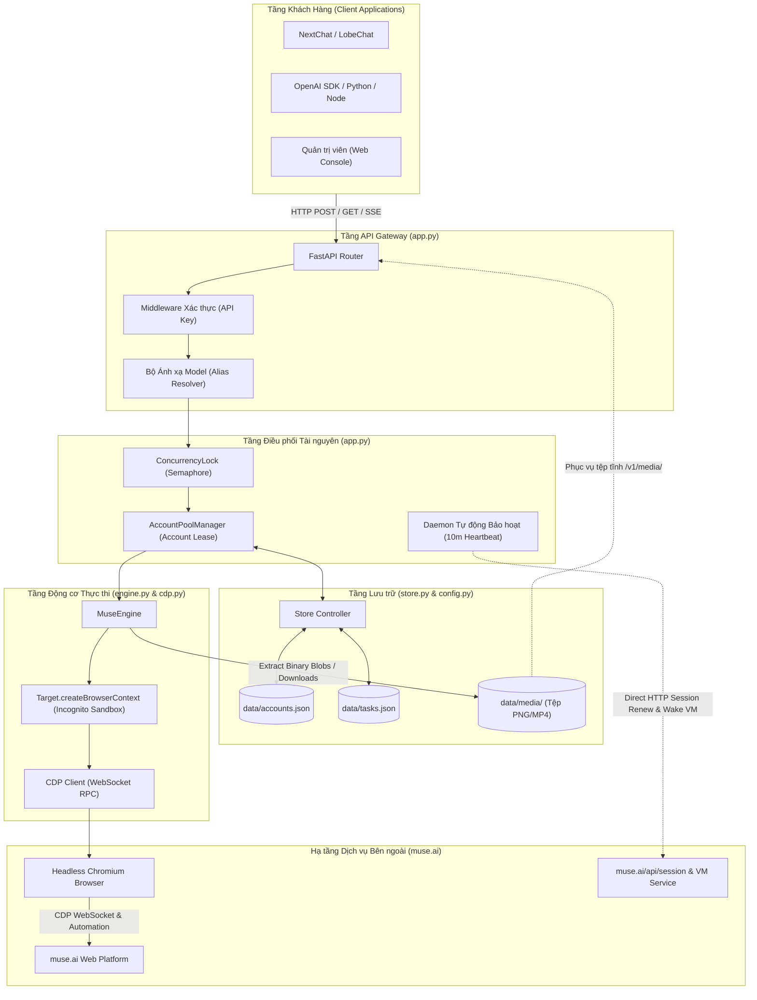
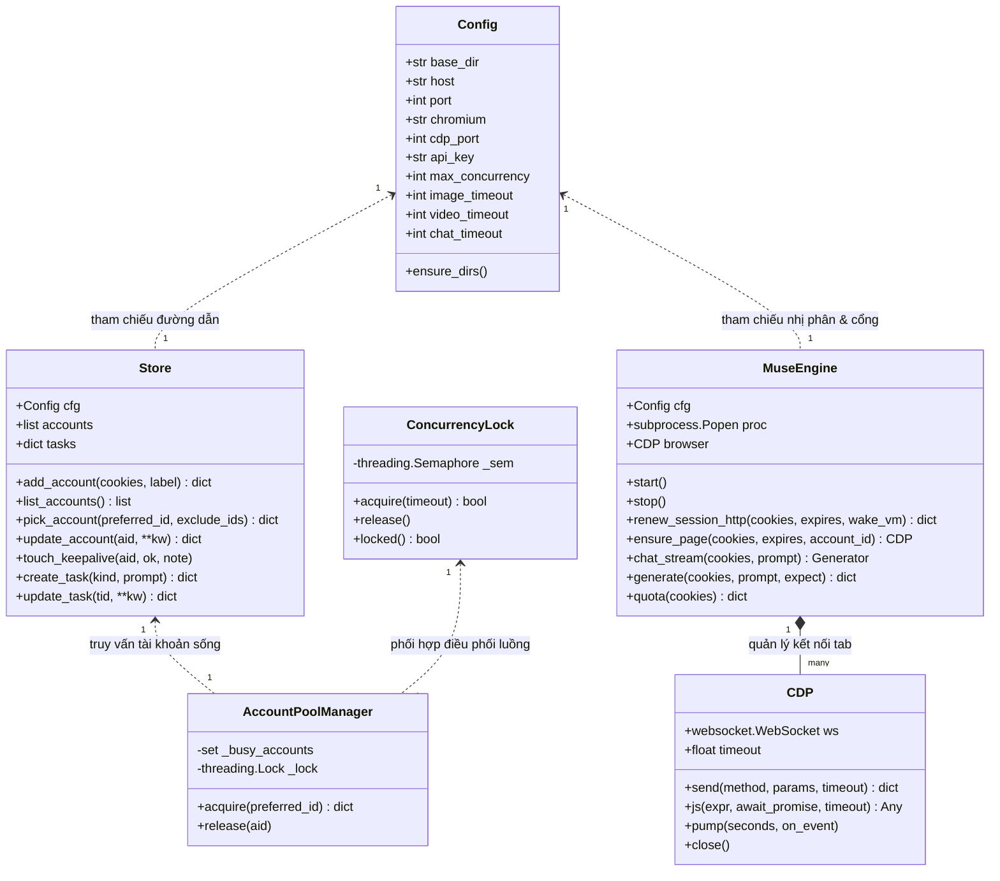

# Kiến Trúc Tổng Thể Hệ Thống MUSE2API

---

## 1. Mô hình Kiến trúc Cấp cao (High-Level Architecture)

**MUSE2API** được thiết kế theo mô hình **Layered Architecture kết hợp Reverse Proxy Automation Gateway**. Hệ thống bao gồm 4 tầng chức năng chính:
1. **Tầng Giao diện & Điều khiển (API Gateway & Presentation Layer)**: Nhận yêu cầu RESTful từ client, xác thực API key, chuyển đổi payload theo chuẩn OpenAI.
2. **Tầng Điều phối & Đồng bộ (Orchestration & Synchronization Layer)**: Kiểm soát số lượng tác vụ đồng thời thông qua Semaphore, quản lý việc thuê/trả tài khoản (Account Leasing), và đảm bảo mỗi tài khoản chỉ xử lý một tác vụ tại một thời điểm.
3. **Tầng Lưu trữ & Trạng thái (Persistence & State Layer)**: Quản lý danh sách tài khoản, thời hạn cookie và hàng đợi tác vụ trên đĩa với cơ chế ghi nguyên tử (Atomic File Writing).
4. **Tầng Động cơ Tự động hóa (Automation Engine Layer)**: Tương tác trực tiếp với tiến trình Chromium qua giao thức Chrome DevTools Protocol (CDP), quản lý các ngữ cảnh trình duyệt ẩn danh (Incognito Contexts) độc lập và điều khiển giao diện web muse.ai.

---

## 2. Các Thành phần Kiến trúc Trọng yếu

### 2.1. ConcurrencyLock & AccountPoolManager
- **ConcurrencyLock**: Sử dụng `threading.Semaphore` với giới hạn tối đa `MUSE2API_CONCURRENCY` (mặc định là 2). Nó đảm bảo máy chủ không bị quá tải CPU/RAM khi nhiều client cùng gửi yêu cầu tạo video hoặc sinh ảnh nặng.
- **AccountPoolManager**:
  - Quản lý danh sách các tài khoản đang bận (`_busy_accounts`).
  - Khi một luồng công việc cần thực thi, nó gọi `acquire()` để thuê một tài khoản đang rảnh rỗi.
  - Sau khi công việc hoàn tất (thành công hoặc thất bại), khối `finally` bắt buộc gọi `release(aid)` để trả tài khoản về hồ chứa.
  - Ngăn ngừa triệt để hiện tượng "giẫm chân nhau" (Session Collision) giữa các luồng khi dùng chung một tài khoản.

### 2.2. Incognito BrowserContext Sandbox
- Thay vì mở cửa sổ trình duyệt riêng biệt cho từng tác vụ (rất tốn RAM và thời gian khởi động), `MuseEngine` sử dụng một tiến trình Chromium duy nhất chạy cờ `--headless=new`.
- Đối với mỗi luồng xử lý hoặc mỗi tài khoản, engine gọi lệnh CDP `Target.createBrowserContext`.
- Trình duyệt sẽ cấp phát một môi trường Sandbox hoàn toàn cô lập: Cookie, LocalStorage, Cache và Session giữa các BrowserContext khác nhau là 100% độc lập.
- Sau khi tác vụ kết thúc, hàm `_close_page()` sẽ gọi `Target.disposeBrowserContext` để giải phóng toàn bộ RAM ngay lập tức.

### 2.3. Cơ chế Duy trì Phiên tự động (48h Keepalive & Cloud VM Wake)
- Nền tảng muse.ai quy định cookie `hatch_vml` có thời hạn sống cố định là 48 giờ. Hết 48 giờ, phiên sẽ chết và đòi hỏi đăng nhập lại.
- Đồng thời, không gian làm việc đám mây (Cloud Workspace VM) của muse.ai sẽ rơi vào trạng thái ngủ đông (`DISABLED` hoặc `SLEEPING`) sau một khoảng thời gian người dùng không tương tác.
- **Giải pháp của muse2api**:
  - Không cần mở giao diện web để thao tác, engine gửi trực tiếp HTTP GET đến `https://muse.ai/api/session` kèm theo Cookie hiện có. Phản hồi thành công sẽ cấp phát giá trị mới cho `hatch_vml` (+48h) và `hatch_sess` (+30d).
  - Nếu `vm_state != "RUNNING"`, engine tự động gửi HTTP POST tới `https://muse.ai/api/hatch/vm/wake` để đánh thức máy ảo, đảm bảo luôn sẵn sàng nhận lệnh mà không bị lỗi timeout `Still sending...`.

---

## 3. Sơ đồ Lớp và Mối quan hệ Đối tượng (Class Diagram)

---

## 4. Liên kết Liên quan

- [Giới thiệu Dự án](gioi-thieu.md)
- [Cấu trúc Thư mục](cau-truc-thu-muc.md)
- [Công nghệ Sử dụng](cong-nghe.md)
- [Các Luồng Xử Lý Chính](../05-luong-xu-ly/chat-streaming.md)
- [Mục lục Tài liệu](../README.md)
