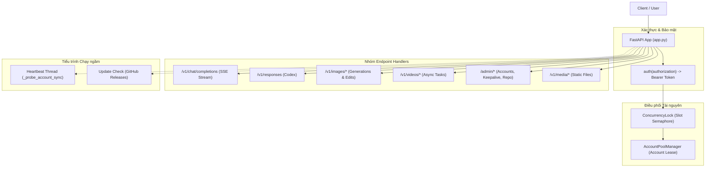

# Module Ứng Dụng & API Server (`app.py`)

---

## 1. Tổng Quan Module

- **File nguồn**: [app.py](file:///e:/Project/muse2api/app.py)
- **Vai trò**: Entry Point của toàn bộ hệ thống, khởi tạo máy chủ FastAPI, cung cấp toàn bộ các endpoints RESTful chuẩn OpenAI, điều phối hàng đợi tác vụ, quản lý trạng thái tài khoản đa luồng và duy trì vòng lặp bảo hoạt tự động (Keepalive Heartbeat).

---

## 2. Kiến Trúc & Các Thành Phần Chính Trong Module

---

## 3. Danh Sách Lớp & Hàm Quan Trọng

### 3.1. Lớp Điều Phối
- `ConcurrencyLock`:
  - Quản lý hạn mức đồng thời thông qua `threading.Semaphore`.
  - Hàm `acquire()` và `release()` bảo vệ máy chủ không bị cạn kiệt tài nguyên.
- `AccountPoolManager`:
  - `acquire(preferred_id)`: Chọn tài khoản rảnh rỗi từ hồ chứa, đánh dấu vào `_busy_accounts`.
  - `release(aid)`: Giải phóng tài khoản khi luồng công việc kết thúc, kích hoạt thread khác đang đợi.

### 3.2. Lớp Dữ Liệu Pydantic Models
- `ChatMessage`: Đại diện cho một tin nhắn trong hội thoại (`role`, `content`).
- `ChatRequest`: Dữ liệu yêu cầu cho endpoint `/v1/chat/completions` (`messages`, `model`, `stream`, `temperature`...).
- `ResponsesRequest`: Dữ liệu yêu cầu cho endpoint `/v1/responses` (Codex protocol).
- `ImageRequest`: Dữ liệu yêu cầu cho `/v1/images/generations` (`prompt`, `size`, `response_format`...).
- `VideoRequest`: Dữ liệu yêu cầu cho `/v1/videos` (`prompt`, `duration`, `aspect_ratio`, `images`...).
- `AccountRequest`, `AccountPatch`: Dữ liệu cho các thao tác quản trị tài khoản tại `/admin/accounts`.

### 3.3. Các Hàm Xử Lý Nghiệp Vụ
- `resolve_model(model)`: Ánh xạ các tên model ảo (`gpt-4o`, `claude-3-5`...) sang hành vi thích hợp.
- `auth(authorization)`: Dependency xác thực API key dạng Bearer Token.
- `build_chat_prompt(messages, model)`: Ghép nối ngữ cảnh nhiều lượt và System prompt thành một câu lệnh duy nhất cho muse.ai.
- `build_image_prompt(prompt, size)`: Chuẩn hóa tỉ lệ hình ảnh (`16:9`, `1:1`...) vào nội dung câu lệnh.
- `build_video_prompt(prompt, duration, aspect_ratio)`: Thêm các chỉ thị thời lượng và khung hình vào câu lệnh sinh video.
- `_run_generation_locked(...)`: Hàm thực thi trung tâm, thuê slot, thuê tài khoản, gọi `engine.generate()` và xử lý tự động đổi tài khoản nếu gặp từ chối (Refusal Rotation).
- `_probe_account_sync(aid)`: Hàm kiểm tra sức khỏe, gia hạn cookie qua HTTP (`/api/session`) và kích hoạt đánh thức VM (`/api/hatch/vm/wake`).

---

## 4. Phụ Thuộc (Dependencies)

- `fastapi`, `pydantic`, `uvicorn`, `requests`.
- Module nội bộ: `config.CFG`, `store.Store`, `engine.MuseEngine`.

---

## 5. Liên kết Liên quan

- [Tài liệu Chi tiết File app.py](../04-chi-tiet-ma-nguon/app-py.md)
- [Module Engine Core](engine-core.md)
- [Tài liệu API](../06-api/tong-quan-api.md)
- [Mục lục Tài liệu](../README.md)
