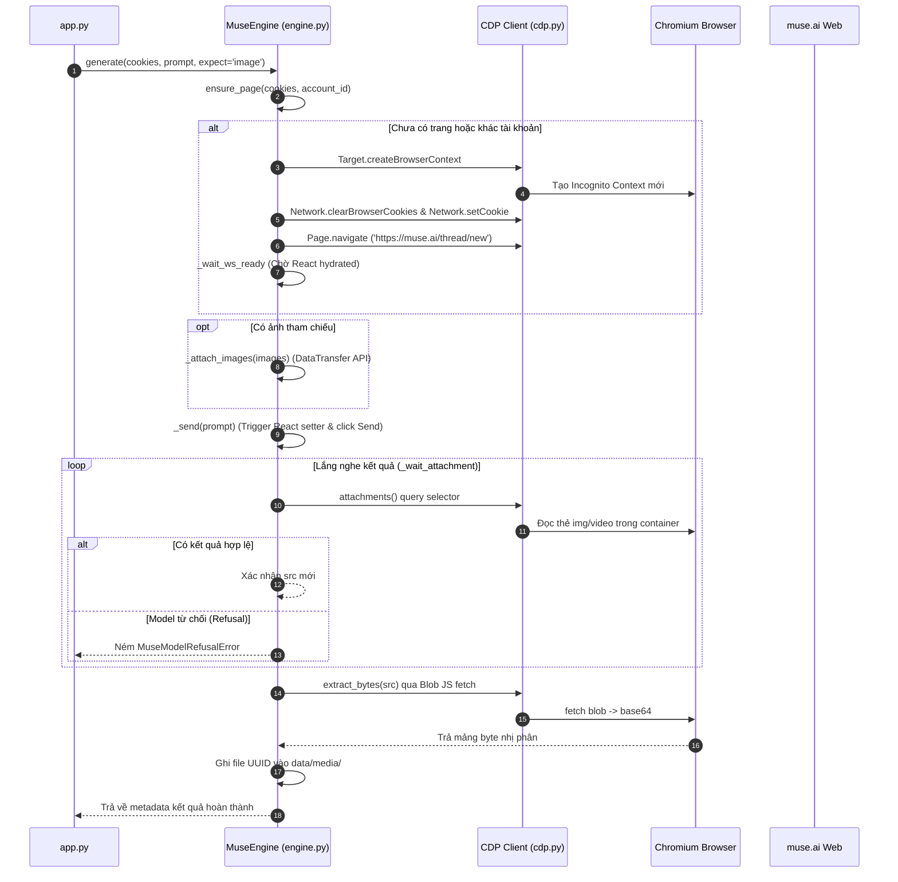

# Module Động Cơ Tự Động Hóa (`engine.py`)

---

## 1. Tổng Quan Module

- **File nguồn**: [engine.py](file:///e:/Project/muse2api/engine.py)
- **Vai trò**: Động cơ cốt lõi thực thi tự động hóa giao diện web muse.ai thông qua trình duyệt Chromium vô đầu (Headless Browser) và giao thức Chrome DevTools Protocol (CDP).
- **Trách nhiệm**:
  - Quản lý vòng đời tiến trình Chromium nền.
  - Cấp phát các môi trường Incognito Sandbox cô lập tuyệt đối theo từng tài khoản.
  - Gia hạn phiên và đánh thức máy ảo container qua HTTP trực tiếp (`renew_session_http`).
  - Điền nội dung prompt vào React textarea và gửi đi.
  - Bơm ảnh tham chiếu (Single / Multi-reference) bằng HTML5 DataTransfer API.
  - Lắng nghe DOM mutation, bắt kết quả hình ảnh/video hoặc bắt lỗi từ chối của mô hình.
  - Trích xuất dữ liệu file nhị phân qua JavaScript Blob hoặc cơ chế click download dự phòng.

---

## 2. Kiến Trúc & Luồng Tương Tác Của MuseEngine



---

## 3. Các Tính Năng Kỹ Thuật Đáng Chú Ý

### 3.1. Kỹ thuật Bơm Văn Bản Tốc Độ Cao Cho React 18
Đối với các prompt siêu dài (như ngữ cảnh chat hàng trăm KB hoặc mã nguồn), nếu dùng `Input.insertText` của CDP thì Chromium sẽ gõ từng ký tự một, mất từ 30 đến 60 giây và có thể gây treo tab.
`MuseEngine` sử dụng giải pháp ghi đè trực tiếp thông qua nguyên mẫu:
```javascript
var s = Object.getOwnPropertyDescriptor(HTMLTextAreaElement.prototype, 'value').set;
s.call(ta, promptText);
ta.dispatchEvent(new Event('input', {bubbles: true}));
ta.dispatchEvent(new Event('change', {bubbles: true}));
```
Nhờ đó, văn bản dù dài đến đâu cũng được nạp vào React state trong **dưới 0.1 giây**, kích hoạt nút Send ngay lập tức.

### 3.2. Cơ Chế Chống SSRF & DNS Rebinding (`_open_public_ref_image`)
Khi người dùng truyền URL ảnh tham chiếu từ xa, kẻ tấn công có thể cố tình truyền địa chỉ mạng nội bộ máy chủ (`http://192.168.1.1` hoặc `http://169.254.169.254`).
Hệ thống sử dụng custom `HTTPHandler` và `HTTPRedirectHandler`:
- Phân giải DNS của hostname thành danh sách địa chỉ IP thực tế.
- Kiểm tra tính hợp lệ qua `ipaddress.ip_address(ip).is_global`.
- Từ chối mọi địa chỉ thuộc dải private, loopback hoặc multicast.
- Ghim kết nối socket trực tiếp vào IP đã được kiểm duyệt an toàn, vô hiệu hóa hoàn toàn nguy cơ bị tấn công DNS Rebinding trong các bước chuyển hướng (Redirect).

### 3.3. Thuật Toán Lắng Nghe Stream Ký Tự Đầu (TTFT 2~3s)
Hàm `chat_stream()` duy trì vòng lặp kiểm tra trạng thái tin nhắn `_poll_chat()` với chu kỳ siêu nhanh **60ms**. Ngay khi mô hình muse.ai vừa bắt đầu xuất ra những từ đầu tiên, hệ thống sẽ `yield` ngay lập tức về client, mang lại trải nghiệm gõ chữ mượt mà như OpenAI chính thống.

---

## 4. Danh Sách Lỗi Ngoại Lệ (Exceptions)

- `MuseAuthError`: Phiên đăng nhập hết hạn hoặc bị đăng xuất (HTTP 401 hoặc xuất hiện màn hình login).
- `MuseGenerationError`: Lỗi runtime chung trong quá trình điều khiển trình duyệt.
- `MuseModelRefusalError`: Model từ chối sinh media và chỉ trả về đoạn chat giải thích lý do (vi phạm chính sách từ khóa).
- `RefImageSafetyError`: Ảnh tham chiếu vi phạm chính sách an toàn mạng/SSRF.

---

## 5. Liên kết Liên quan

- [Tài liệu Chi tiết File engine.py](../04-chi-tiet-ma-nguon/engine-py.md)
- [Module CDP Driver](cdp-driver.md)
- [Luồng Xử Lý Sinh Ảnh](../05-luong-xu-ly/text-to-image.md)
- [Mục lục Tài liệu](../README.md)
