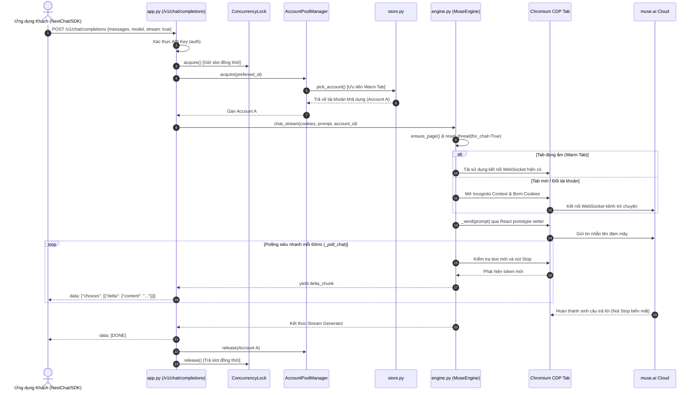

# Luồng Xử Lý: Hội Thoại & Stream SSE (`/v1/chat/completions`)

---

## 1. Mô Tả Luồng Nghiệp Vụ

Luồng hội thoại xử lý yêu cầu trò chuyện văn bản và viết mã nguồn, hỗ trợ cả hai chế độ:
1. **Chế độ Stream (`stream=True`)**: Trả về dữ liệu theo định dạng Server-Sent Events (SSE) theo chuẩn OpenAI, ký tự đầu tiên phản hồi cực nhanh sau **2~3 giây**.
2. **Chế độ Đồng bộ (`stream=False`)**: Gom toàn bộ câu trả lời hoàn chỉnh và trả về một đối tượng JSON duy nhất.

Cơ chế **Warm-Tab Affinity** được áp dụng: Nếu trang web đang ở trạng thái sạch, không có tệp đính kèm và số lượng tin nhắn ít hơn 24 bong bóng, hệ thống tái sử dụng ngay tab trình duyệt hiện có mà không reload, giảm thiểu độ trễ bắt đầu.

---

## 2. Sơ Đồ Tuần Tự (Sequence Diagram)

---

## 3. Các Điểm Cần Lưu Ý
- Nếu kết nối giữa Client và Server bị ngắt sớm (Client Abort), `Request.is_disconnected()` sẽ kích hoạt `stop_event.set()`, lập tức dừng vòng lặp polling trên engine để tiết kiệm tài nguyên máy chủ.

---

## 4. Liên kết Liên quan
- [Module App API](../03-module/app-api.md)
- [Module Engine Core](../03-module/engine-core.md)
- [Chi Tiết API Chat Completions](../06-api/chat-completions.md)
- [Mục lục Tài liệu](../README.md)
