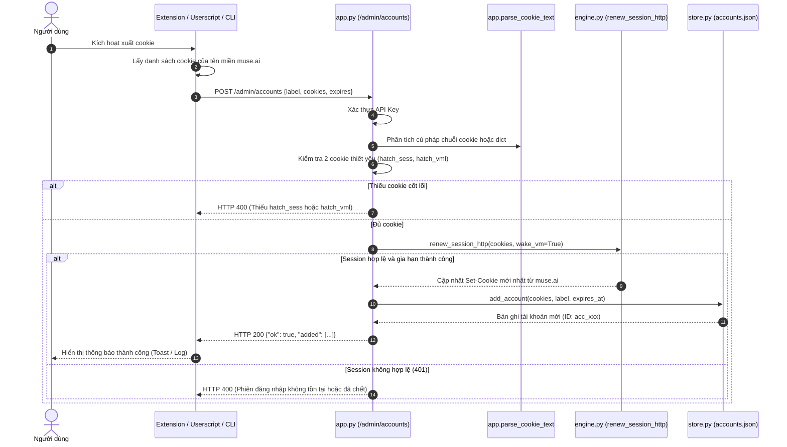

# Luồng Xử Lý: Đồng Bộ & Nhập Cookie Tài Khoản

---

## 1. Mô Tả Luồng Nghiệp Vụ

Để đưa một tài khoản muse.ai vào hệ thống muse2api, người dùng có 3 phương pháp nhập:
1. **Qua Chrome Extension**: Nhấn vào biểu tượng extension trên trình duyệt Chrome đã đăng nhập muse.ai $\rightarrow$ Extension tự đọc `chrome.cookies` $\rightarrow$ POST về `/admin/accounts`.
2. **Qua Userscript Tampermonkey**: Mở trang web `https://muse.ai/` $\rightarrow$ Nhấn vào nút tròn nổi ⚡ $\rightarrow$ Nhấn "Đẩy vào hồ chứa".
3. **Qua CLI Helper (`get_muse_cookie.py`)**: Chạy script dòng lệnh, script tự mở Chrome và bắt cookie qua CDP.

Cả 3 phương thức cuối cùng đều gọi về endpoint `/admin/accounts` của muse2api để xử lý bóc tách và lưu trữ.

---

## 2. Sơ Đồ Tuần Tự (Sequence Diagram)

---

## 3. Liên kết Liên quan
- [Module Chrome Extension](../03-module/chrome-extension.md)
- [Module Tools Helpers](../03-module/tools-helpers.md)
- [Chi Tiết API Admin](../06-api/admin-management-api.md)
- [Mục lục Tài liệu](../README.md)
