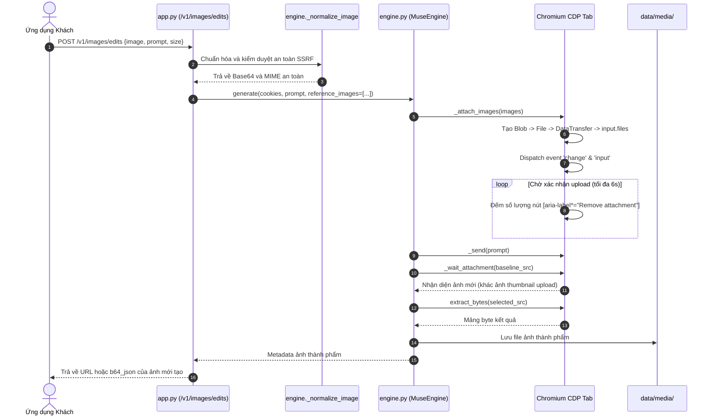

# Luồng Xử Lý: Chỉnh Sửa Ảnh Tham Chiếu (`/v1/images/edits`)

---

## 1. Mô Tả Luồng Nghiệp Vụ

Endpoint `/v1/images/edits` hỗ trợ tiếp nhận hình ảnh tham chiếu (Single-reference hoặc Multi-reference lên tới 4 ảnh) qua Multipart Form Data hoặc JSON Base64/URL, sau đó:
1. Thẩm định an toàn nguồn ảnh (chặn IP private / SSRF).
2. Chuẩn hóa ảnh về chuỗi Base64 và MIME type.
3. Bơm các file ảnh vào phần tử `input[type="file"]` của composer trên muse.ai qua JavaScript DataTransfer API.
4. Chờ giao diện hiển thị nút "Remove attachment / 移除附件" để đảm bảo upload đã thành công trước khi gửi lệnh.
5. Gửi câu nhắc chỉnh sửa và đón nhận hình ảnh kết quả mới sinh (loại trừ các thumbnail ảnh gốc đã upload).

---

## 2. Sơ Đồ Tuần Tự (Sequence Diagram)

---

## 3. Liên kết Liên quan
- [Luồng Xử Lý Văn Bản Sinh Ảnh](text-to-image.md)
- [Chi Tiết API Images](../06-api/images-generations-edits.md)
- [Mục lục Tài liệu](../README.md)
