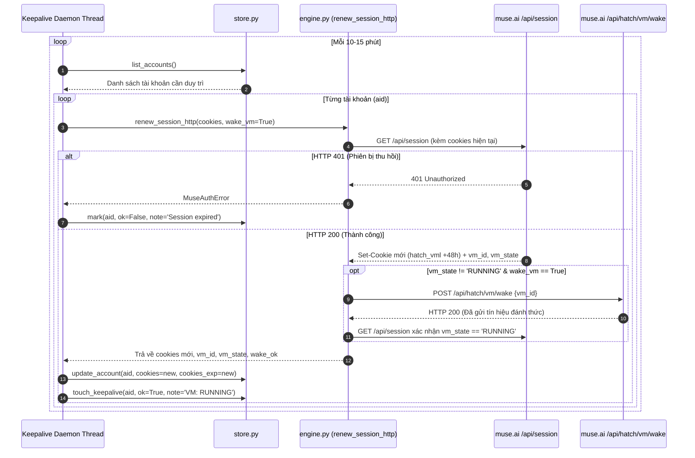

# Luồng Xử Lý: Tự Động Duy Trì Phiên & Đánh Thức VM (Keepalive)

---

## 1. Mô Tả Luồng Nghiệp Vụ

Nhằm giải quyết triệt để vấn đề cookie `hatch_vml` hết hạn sau 48 giờ và máy ảo muse.ai ngủ đông dẫn đến timeout khi có request người dùng, hệ thống triển khai một tiểu trình daemon chạy ngầm liên tục:
1. Chu kỳ lặp: Mỗi 10 đến 15 phút một lần.
2. Quét toàn bộ tài khoản đang được kích hoạt (`enabled=True`) trong `store.accounts`.
3. Gửi request HTTP GET tới `https://muse.ai/api/session` để gia hạn cookie.
4. Nếu trạng thái VM chưa đạt `RUNNING`, gửi request POST tới `https://muse.ai/api/hatch/vm/wake` để đánh thức.
5. Cập nhật cookie mới và mốc thời gian `last_keepalive` vào `store.py`.

---

## 2. Sơ Đồ Tuần Tự (Sequence Diagram)

---

## 3. Liên kết Liên quan
- [Module Store Storage](../03-module/store-storage.md)
- [Module Engine Core](../03-module/engine-core.md)
- [Mục lục Tài liệu](../README.md)
