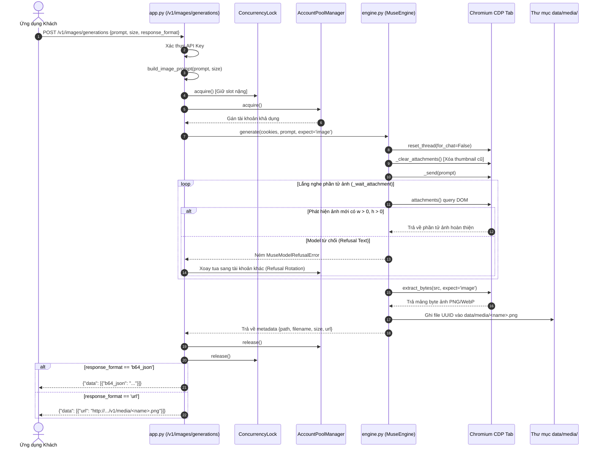

# Luồng Xử Lý: Văn Bản Sinh Hình Ảnh (`/v1/images/generations`)

---

## 1. Mô Tả Luồng Nghiệp Vụ

Endpoint `/v1/images/generations` tiếp nhận câu nhắc (prompt) và kích thước mong muốn (`1024x1024`, `1792x1024`, `1024x1792`...), sau đó:
1. Chuẩn hóa câu nhắc kèm tỉ lệ khung hình (`1:1`, `16:9`, `9:16`...).
2. Dọn dẹp các ảnh đính kèm cũ trong khung soạn thảo (`_clear_attachments`).
3. Gửi prompt lên muse.ai và chờ phần tử ảnh hoàn thiện xuất hiện.
4. Trích xuất dữ liệu ảnh nhị phân trực tiếp từ DOM qua JavaScript Blob Fetching.
5. Lưu tệp cục bộ và trả về URL hoặc chuỗi Base64 cho client.

---

## 2. Sơ Đồ Tuần Tự (Sequence Diagram)

---

## 3. Liên kết Liên quan
- [Luồng Xử Lý Chỉnh Sửa Ảnh Tham Chiếu](image-to-image.md)
- [Chi Tiết API Images](../06-api/images-generations-edits.md)
- [Mục lục Tài liệu](../README.md)
