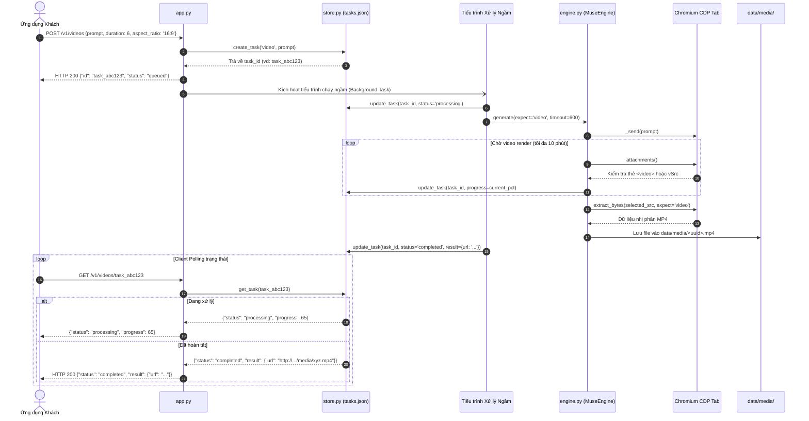

# Luồng Xử Lý: Sinh Video Bất Đồng Bộ (`/v1/videos`)

---

## 1. Mô Tả Luồng Nghiệp Vụ

Thời gian tạo một video chất lượng cao từ muse.ai thường mất từ 1 đến 5 phút. Để tránh tình trạng client bị HTTP Timeout khi giữ kết nối lâu, hệ thống triển khai kiến trúc **Tác vụ Hàng đợi Bất đồng bộ (Async Task Architecture)**:
1. **Khởi tạo tác vụ (`POST /v1/videos`)**: Nhận câu lệnh, tạo một bản ghi `task_id` với trạng thái `queued` và trả về ngay mã nhiệm vụ cho client trong vòng 0.2 giây.
2. **Xử lý ngầm (Background Worker)**: Một tiểu trình ngầm sẽ thực thi tác vụ qua `_run_generation_locked`: nạp ảnh bắt đầu (nếu có), gửi prompt và đợi container video render xong.
3. **Truy vấn trạng thái (`GET /v1/videos/{task_id}`)**: Client định kỳ polling mỗi vài giây để nhận tiến độ phần trăm và lấy link xem video khi hoàn tất.

---

## 2. Sơ Đồ Tuần Tự (Sequence Diagram)

---

## 3. Liên kết Liên quan
- [Chi Tiết API Video](../06-api/videos-generations.md)
- [Module Engine Core](../03-module/engine-core.md)
- [Mục lục Tài liệu](../README.md)
